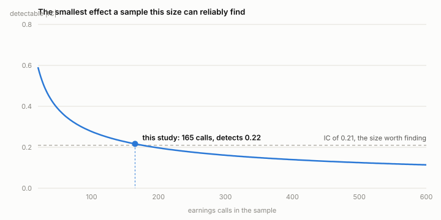
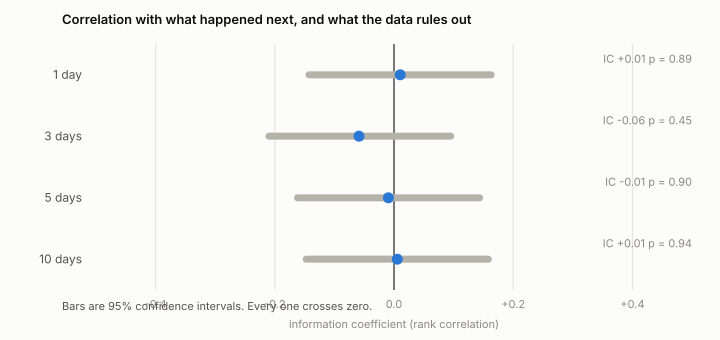

# Investigating earnings call sentiment

Executives answer analysts unscripted for half an hour, and the tone of those answers might carry something the market hasn't priced yet. I knew this effect that would obviously be small, so I tried to quantify how many calls were required until the signal would become significant.

I started by taking 165 earnings calls and tested how strong a return signal I could get from the tone of the Q&A. At that sample size, the test can only reliably detect a correlation of 0.22 or larger. To have a realistic chance at seeing a signal worth trading, the sample would need to be roughly 3,100 calls.

The 165 measured result, nothing of value: IC -0.009, p = 0.90.

<picture>
  <source media="(prefers-color-scheme: dark)" srcset="docs/figures/power-curve-dark.svg">
  
</picture>

## Parts

- Parsed 174 PDF transcripts into speaker turns, tagged with timestamps, who was talking, and what their role was
- Scored only the Q&A, turn by turn, because prepared remarks are written days ahead by the investor-relations team
- Measured drift over the following days rather than the jump on the day, stripped out the market, and scaled by each stock's own volatility
- Fixed the headline test and the power calculation before running the model for an honest result
- 77 tests, design decisions written up in [docs/adr](docs/adr/).

## Method

**Extract the Q&A section**  Only the unscripted Q&A is worth scoring. Can be a challenge to parse correctly, as errors are often silent

**Label speaker paragraphs** FinBERT is a language model trained on financial text; it reads 512 tokens at a time, and a Q&A session runs to twenty thousand words. Hence each speaker turn is scored separately and the call's score is the average

**Measure drift** The price jump when results are announced is gone in seconds and isn't tradeable from a transcript you read afterwards. So the target is drift: what the stock does over the following 1, 3, 5 and 10 days, starting from the close of the day after the call. The market's own move is subtracted out, and the result is divided by the stock's volatility 

**Investigate results** I measured using the information coefficient (IC): the rank correlation between what the score predicted and what happened. A small IC sustained across a wide universe is typically useful signal in practice, but small samples can't see small effects

## Results

A correlation has to clear a noise floor set by how much data you have, can be calculated with Fisher's transform. An IC is roughly normal with standard error `1/sqrt(n-3)`, so the smallest one a test catches 80% of the time at 5% significance is

```
IC_min = tanh( (z_0.975 + z_0.80) / sqrt(n - 3) )
       = tanh( 2.80 / sqrt(n - 3) )
```

At n = 165 that is `tanh(2.80 / 12.73)` = **0.217**. Rearranged gives me the required n:

```
n = 3 + ( 2.80 / artanh(IC) )^2
```

A signal worth trading at around 0.05 needs **3,138 calls**.

Using my data, with a 5-day drift:

```
IC -0.009    95% CI [-0.162, +0.144]    p = 0.90    n = 165
```

Essentially a zero: 48.5% called correctly against a naive 53.3% base rate.

Testing across windows and companies:

<picture>
  <source media="(prefers-color-scheme: dark)" srcset="docs/figures/ic-by-horizon-dark.svg">
  
</picture>

| Cut | Result |
|---|---|
| Ways of averaging turns | word-weighted +0.03, management only +0.03, analysts only -0.05 |
| Per company | 3M is the largest at -0.25 (p = 0.10), which becomes p = 0.52 once corrected for testing five names |

None of these alternatives rules out an effect of the size that would actually matter. With a detectable floor of 0.22, a really large signal is needed.


## Limitations

- **Five companies, 165 calls.** The dataset covers only 3M, Deere, Carnival, Alcoa and Stellantis from 2011 to 2026
- **No earnings-surprise control.**
- **FinBERT is used unchanged.** With fewer than 200 calls there is nothing to fine-tune on

## Taking it further

Widen the universe before anything else; nothing here is worth refining at n=165. After that, sector-neutralise the returns, control for the earnings surprise so tone is measured on top of it rather than alongside it, and walk the test forward in time instead of pooling.

## Running it

Requires Python 3.11+. Transcripts are licensed and not included.

```
pip install -e ".[dev]"
pytest                                    # 77 tests
python -m experiments.build_dataset --parse --pdf-dir transcripts_pdf_archive
python -m experiments.score               # the only slow step, resumable
python -m experiments.headline
python docs/figures/power_curve.py        # README figures
python docs/figures/ic_by_horizon.py
```

`score` caches every call as it finishes, so stopping it costs nothing — it picks up where it left off. Design decisions are in [docs/adr](docs/adr/).
